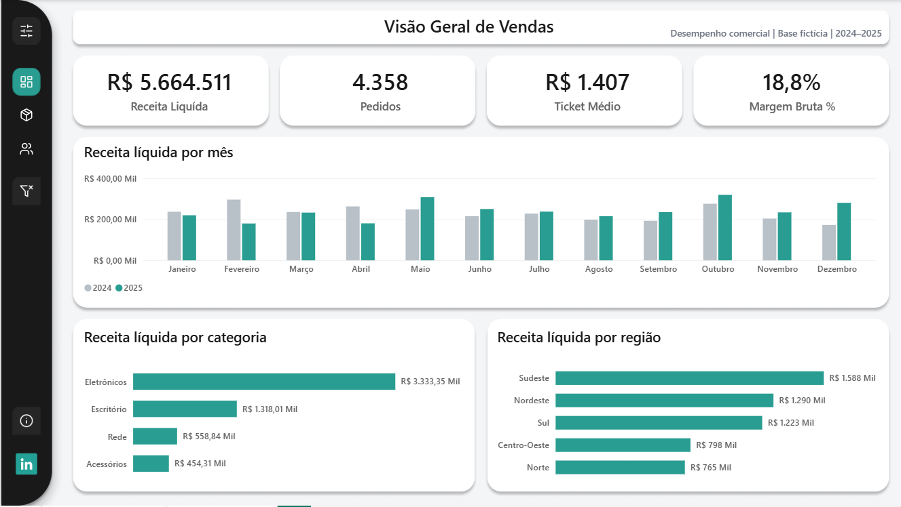
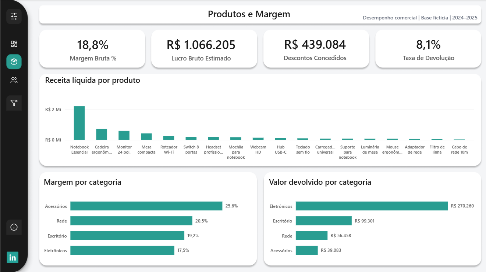
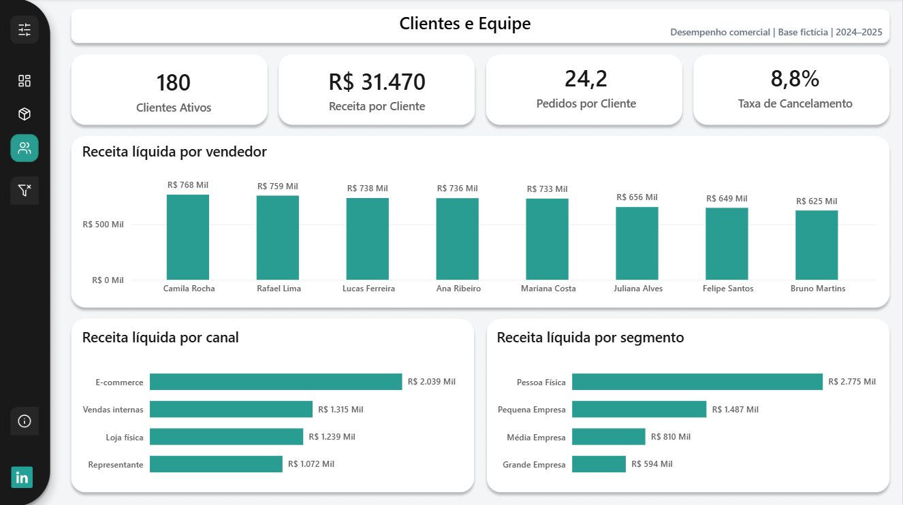
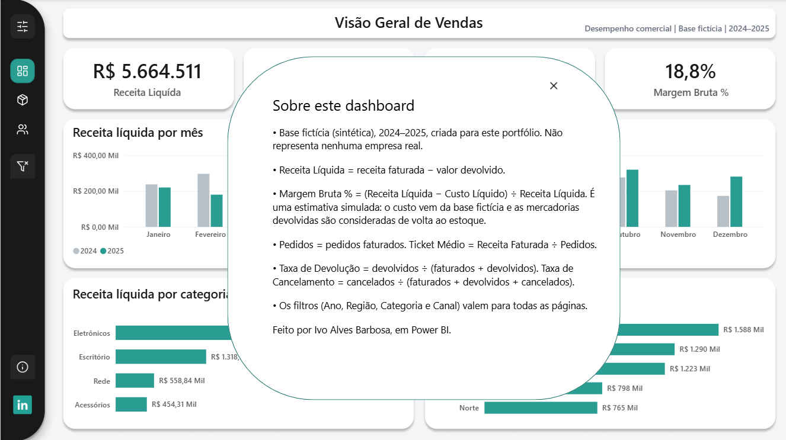

# Dashboard de Vendas em Power BI

Dashboard executivo de vendas com 3 páginas, construído em Power BI Desktop sobre uma base **100% fictícia** (2024–2025). O projeto mostra modelagem dimensional, medidas DAX validadas, design de interface com menu lateral retrátil e documentação das premissas.

> **Aviso:** os dados são sintéticos e não representam nenhuma empresa real. A margem bruta é uma **estimativa simulada** (veja [Premissas e limitações](docs/05_premissas_e_limitacoes.md)).

## Visão geral das páginas

| Visão Geral | Produtos e Margem | Clientes e Equipe |
|---|---|---|
|  |  |  |

Popup "Sobre este dashboard", com as definições das métricas e o aviso de base fictícia:



## Perguntas que o dashboard responde

- Quanto a empresa vendeu, depois de descontar as devoluções, e como isso evoluiu mês a mês em 2024 e 2025?
- Quais categorias, regiões, canais e segmentos mais contribuem para a receita?
- Quais produtos vendem mais e qual é a margem estimada por categoria?
- Quanto se perde em devoluções e cancelamentos?
- Quantos clientes estão ativos e quanto cada vendedor entrega?

## Principais recursos

- **Menu lateral retrátil** (fechado: 72 px; aberto: 240 px) feito com bookmarks. Aberto, ele mostra os filtros de Ano, Região, Categoria e Canal.
- **Filtros sincronizados** entre as 3 páginas.
- **Selo de filtros ativos** no menu fechado e botão **Limpar filtros**.
- **Popup "Sobre"** em cada página, com as definições das métricas.
- Tema próprio (`theme/Tema_Vendas.json`) e layout desenhado no Figma, inspirado no UI kit Finebank (Figma Community).

## Como abrir

1. Instale o **Power BI Desktop** (versão recente, gratuita).
2. Abra `powerbi/Dashboard_Vendas.pbix`.
3. No Desktop, as ações de botões e bookmarks funcionam com **Ctrl + clique**.

Se o Power BI pedir para atualizar os dados, aponte para os arquivos da pasta `data/`.

## Estrutura do repositório

```
dashboard-vendas-powerbi/
├── powerbi/          Dashboard_Vendas.pbix
├── data/             Base fictícia (CSVs e Excel)
├── docs/             Problema, dados, dicionário, modelo e DAX, premissas, validação
├── assets/           Prints e ícones (Lucide, licença ISC)
├── theme/            Tema JSON do Power BI
└── README.md
```

## Documentação

1. [Problema e objetivos](docs/01_problema_e_objetivos.md)
2. [Dados e origem](docs/02_dados_e_origem.md)
3. [Dicionário de dados](docs/03_dicionario_de_dados.md)
4. [Modelo e medidas DAX](docs/04_modelo_e_medidas_dax.md)
5. [Premissas e limitações](docs/05_premissas_e_limitacoes.md)
6. [Validação dos números](docs/06_validacao.md)

## Tecnologias

Power BI Desktop, Power Query, DAX, modelagem em estrela, bookmarks e Painel de Seleção, Figma (layout), ícones Lucide.

## Como foi construído

Projeto feito por mim, passo a passo, com acompanhamento do Claude (IA da Anthropic) como mentor: ele explicou conceitos e sugeriu o caminho, e eu montei o modelo, as medidas e as páginas no Power BI e conferi cada número contra cálculos independentes.

## Autor

**Ivo Alves Barbosa** — estudante de Análise e Desenvolvimento de Sistemas, em transição para a área de TI e Salesforce.
[LinkedIn](https://www.linkedin.com/in/ivoabarbosa)

## Créditos

- Inspiração visual: *Finebank – Financial Management Dashboard UI Kit* (Figma Community). Nenhum arquivo do kit foi incluído neste repositório.
- Ícones: [Lucide](https://lucide.dev) (licença ISC).
